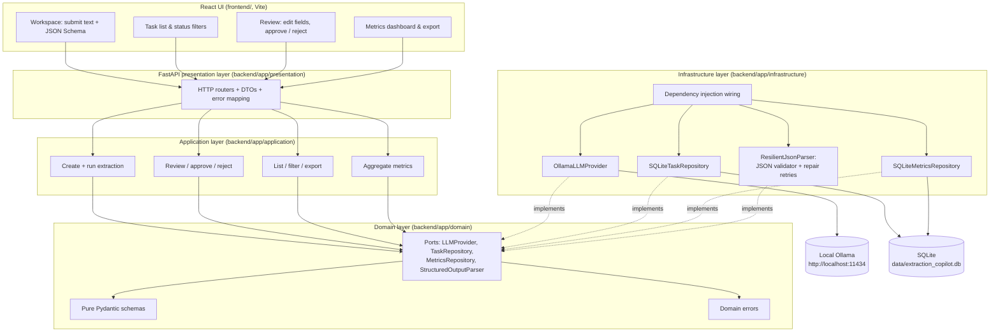

# AI Task & Structured Extraction Copilot

A clean, modular, **local-first** full-stack application that turns unstructured text into
schema-validated structured data using a **local Ollama model**, with human-in-the-loop
review, SQLite persistence, CSV/JSON export, and observability metrics.

**No paid APIs. No external cloud services. No model-family-specific prompts or stop tokens.**

---

## Table of contents

- [Architecture](#architecture)
- [Clean Architecture layer map](#clean-architecture-layer-map)
- [Tech stack](#tech-stack)
- [Quick start](#quick-start)
- [Configuration & model-agnostic usage](#configuration--model-agnostic-usage)
- [API reference](#api-reference)
- [Frontend workspace](#frontend-workspace)
- [Testing](#testing)
- [Edge cases & limitations](#edge-cases--limitations)
- [Extending the system](#extending-the-system)

---

## Architecture



Data flow: the UI calls FastAPI routers, which only translate HTTP DTOs into
application use-case calls. Use cases orchestrate domain objects through port
interfaces. Infrastructure adapters implement those ports and talk to Ollama/SQLite.

---

## Clean Architecture layer map

| Layer | Location | May depend on | Contains |
| --- | --- | --- | --- |
| **Domain** | `backend/app/domain/` | Nothing external (Pydantic only) | `ExtractionTask`, `ExtractedPayload`, `TaskStatus`, `ExtractionMetrics`, `ReviewDecision`, domain errors, abstract ports `LLMProvider` / `TaskRepository` / `MetricsRepository` / `StructuredOutputParser` |
| **Application** | `backend/app/application/` | `domain/` (+ stdlib) | Use cases: create/run extraction, bounded schema repair (via parser port), human review, list/filter, export, metrics aggregation |
| **Infrastructure** | `backend/app/infrastructure/` | `domain/`, `application/`, vendor libs | `OllamaLLMProvider`, `SQLiteTaskRepository`, `SQLiteMetricsRepository`, resilient JSON extractor/validator, config, DI composition root |
| **Presentation** | `backend/app/presentation/` | `application/`, `domain/` | FastAPI routers, request/response DTOs, domain-error → HTTP mapping, `/health` |

**Strict loose coupling guarantees:**

- Domain has **zero framework/vendor imports** (no FastAPI, SQLAlchemy, httpx, Ollama).
- Application depends only on domain ports and pure stdlib utilities.
- Swapping Ollama for another LLM (or SQLite for another database) only requires a new
  adapter in `infrastructure/` plus a change in `infrastructure/di.py`. Domain and
  application code stay untouched.
- Routers call use cases only — no business logic in the presentation layer.

---

## Tech stack

- **Backend:** Python 3.11+, FastAPI, Pydantic v2, pydantic-settings, httpx, stdlib `sqlite3`
- **Frontend:** React 19 + Vite (plain CSS, no external component/CDN dependencies)
- **LLM:** any local Ollama model through `/api/generate`
- **Tests:** pytest + pytest-asyncio, FastAPI `TestClient`, in-memory fake adapters
- **Zero paid services:** everything runs on localhost

---

## Quick start

### 1. Install backend dependencies

```powershell
python -m venv .venv
.\.venv\Scripts\python -m pip install -r backend\requirements.txt
```

```bash
python3 -m venv .venv
source .venv/bin/activate
pip install -r backend/requirements.txt
```

### 2. Configure environment

```powershell
copy .env.example .env
```

Edit `.env` if needed (defaults work out of the box). See
[Configuration](#configuration--model-agnostic-usage).

### 3. Start Ollama and pull a model (optional for live extraction)

```bash
ollama serve
ollama pull qwen2.5:7b-instruct-q4_k_m
```

Ollama does **not** need to be running for tests or for backend startup/health checks.

### 4. Run the backend

From the repository root:

```powershell
$env:PYTHONPATH = (Join-Path (Get-Location) 'backend\app')
.\.venv\Scripts\python -m uvicorn presentation.main:app --reload --port 8000
```

```bash
PYTHONPATH=backend/app python -m uvicorn presentation.main:app --reload --port 8000
```

Interactive API docs: <http://localhost:8000/docs> · Health: <http://localhost:8000/health>

### 5. Run the frontend

```powershell
cd frontend
npm install
npm run dev
```

Open <http://localhost:5173>. Vite proxies `/api` and `/health` to port 8000.
To target a different backend, copy `frontend/.env.example` to `frontend/.env` and set
`VITE_API_BASE_URL`.

To build a production bundle: `npm run build` (output in `frontend/dist/`).

### Offline demo without Ollama

A tiny stdlib fake Ollama server is included for demonstrations:

```powershell
.\.venv\Scripts\python backend\tools\fake_ollama.py --port 11434
```

It returns deterministic schema-valid JSON (including optional reasoning tags/fences),
so you can exercise the full UI → API → extraction → review → metrics flow with no model.

---

## Configuration & model-agnostic usage

All settings come from `.env` / environment variables (see `.env.example`):

| Variable | Default | Purpose |
| --- | --- | --- |
| `OLLAMA_BASE_URL` | `http://localhost:11434` | Local Ollama endpoint |
| `OLLAMA_MODEL` | `qwen2.5:7b-instruct-q4_k_m` | Model identifier sent to Ollama |
| `OLLAMA_TIMEOUT` | `60` | Request timeout in seconds |
| `MAX_INPUT_LENGTH` | `50000` | Max input characters (longer → HTTP 422) |
| `DEFAULT_MAX_RETRIES` | `2` | Bounded schema-repair retry count |
| `DB_PATH` | `data/extraction_copilot.db` | SQLite database file |

**Swap models freely** — no code changes required:

```powershell
$env:OLLAMA_MODEL = "gemma2"        # or deepseek-r1, llama3.1, mistral, ...
```

Prompts are written generically (extract data → return one JSON object matching the
schema). Reasoning tags such as `<think>…</think>` and markdown code fences are stripped
**before** JSON parsing. No model-family-specific prompts or stop tokens exist anywhere
in the codebase. Behavior is controlled by the JSON Schema supplied by the caller or the
`DEFAULT_SCHEMA` in `infrastructure/config.py`.

---

## API reference

| Method | Path | Description |
| --- | --- | --- |
| `GET` | `/health` | Liveness check (never requires Ollama) |
| `POST` | `/api/tasks` | Create and run extraction. Body: `{input_text, schema?, max_retries?}` |
| `GET` | `/api/tasks` | List tasks; `?status=pending_review` filters |
| `GET` | `/api/tasks/{task_id}` | Inspect task details, fields, and metrics |
| `PATCH` | `/api/tasks/{task_id}/review` | Edit fields, approve/reject, add notes. Body: `{decision, fields?, notes?, reviewer?}` |
| `GET` | `/api/tasks/export` | Export as JSON or CSV: `?fmt=json\|csv&status=` |
| `GET` | `/api/metrics` | Aggregated observability statistics |

Example:

```bash
curl -X POST http://localhost:8000/api/tasks \
  -H "Content-Type: application/json" \
  -d '{"input_text": "Ada wrote the first algorithm in 1843."}'
```

Structured errors use `{"error": "ErrorName", "message": "..."}`, e.g. `422` for
empty/oversized input, `404` for unknown task ids, `400` for invalid review transitions,
and `502`/`504` for unreachable/timed-out LLM providers.

---

## Frontend workspace

- **Workspace** — submit unstructured text, optionally edit the JSON Schema and retry budget,
  and see the latest extracted fields and latency/retry metrics.
- **Tasks** — filter by status, click a row to inspect; edit extracted fields (including
  adding new ones), add notes/reviewer, then **Save & Approve** or **Save & Reject**.
  Export the current filter as JSON or CSV.
- **Metrics** — total tasks, schema-validation success rate, average latency, repair retries,
  status distribution, and models used.

Terminal statuses (`approved`, `rejected`) cannot be re-reviewed.

---

## Testing

```powershell
.\.venv\Scripts\python -m pytest
```

```bash
pytest
```

The suite (60+ tests) covers:

- Schema validation, `<think>`/fence stripping, brace balancing, trailing-comma repair
- Bounded retry/repair loops and retry accounting
- Human-in-the-loop review edits, approval, rejection, invalid transitions, missing ids
- JSON/CSV export including the empty dataset
- Metrics math including division-by-zero on an empty database
- FastAPI endpoints fully offline via dependency overrides with mocked LLM/repository adapters
- SQLite CRUD, status filtering, per-task metrics joins, and Ollama transport-error mapping
- Architecture guardrails asserting domain/application never import framework or infrastructure modules

No Ollama server, network access, or paid service is needed to run the tests.

---

## Edge cases & limitations

| Edge case | Behavior |
| --- | --- |
| Empty / whitespace-only input | Rejected with HTTP `422` (`EmptyInputError`) |
| Oversized input | Rejected with HTTP `422` (`InputTooLongError`) naming the configured limit |
| Malformed / partial JSON | Think tags and fences stripped; bounded repair retries (`max_retries`, default 2) try brace balancing and trailing-comma fixes; parse failures → `failed_validation` with diagnostic details |
| Schema-invalid fields | Parsed but non-conforming payload → `needs_manual_fix`; reviewer can edit fields in the UI and approve/reject |
| Unreachable Ollama / timeout | Structured `502`/`504` HTTP errors; task persisted with `failed_validation` diagnostic; API never crashes |
| Unknown `task_id` | `404` (`TaskNotFoundError`) |
| Invalid review transition | `400` (`InvalidStatusTransitionError`) for terminal statuses |
| Empty export | Valid `[]` (JSON) or header-only CSV |
| Empty metrics dataset | All rates/averages `0.0`; no division by zero |
| Very large models | Ollama itself may need more RAM/VRAM; use smaller quantizations on constrained machines |

**Limitations:**

- The extractor validates a practical JSON Schema subset (`type`, `required`, `properties`,
  `items`), not the full JSON Schema specification (no `$ref`, `oneOf`, `pattern`, etc.).
- Repair is deterministic and bounded; it cannot invent missing semantic content. A model
  that repeatedly returns invalid data should be re-prompted by a human or swapped via
  `OLLAMA_MODEL`.
- `SQLiteMetricsRepository` aggregates validation success rate over recorded metric rows
  rather than re-validating stored payloads; manual field edits during review set
  `schema_validation_success` to false to signal that re-validation is needed.
- CORS allows all origins for local development; restrict `allow_origins` in
  `presentation/main.py` for production deployment.
- This is a local copilot, not an authentication- or multi-tenancy-enabled SaaS backend.

---

## Extending the system

**New LLM provider:** implement `domain.ports.LLMProvider` in a new
`infrastructure/*_provider.py`, return it from `infrastructure/di.py`, and keep
`domain/`, `application/`, and `presentation/` unchanged.

**New repository/database:** implement `domain.ports.TaskRepository` /
`MetricsRepository` in `infrastructure/` and swap the binding in the DI container.
SQLite-specific code never leaks into inner layers.

**New output parser:** implement `domain.ports.StructuredOutputParser` in
`infrastructure/` and rebind it in the DI container; use cases keep calling the port.

**New extraction schema:** pass a JSON Schema in the POST body (or change
`DEFAULT_SCHEMA` in `infrastructure/config.py`). No prompt changes are required.

---

### Project tree

```text
├── backend/
│   ├── app/
│   │   ├── domain/          schemas.py · errors.py · ports.py
│   │   ├── application/     use_cases.py
│   │   ├── infrastructure/  config.py · ollama_provider.py · sqlite_repo.py
│   │   │                   extractor.py · di.py
│   │   └── presentation/    main.py · routers.py · dto.py · deps.py · exceptions.py
│   ├── requirements.txt
│   └── tools/fake_ollama.py
├── frontend/               React + Vite UI (src/components/…)
├── tests/                  conftest.py + domain/app/infra/API tests
├── .env.example
├── pytest.ini
└── README.md
```
